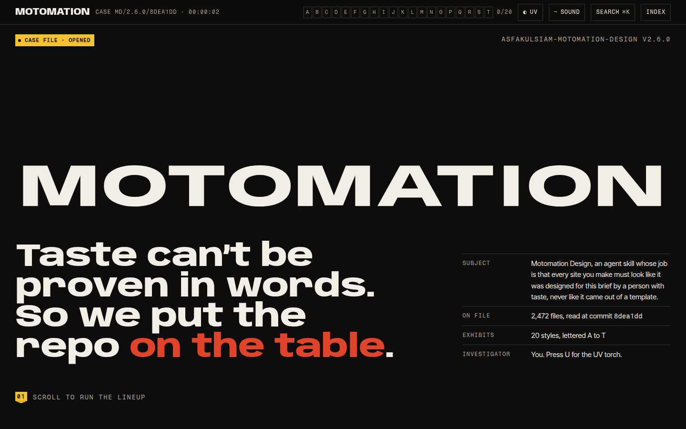
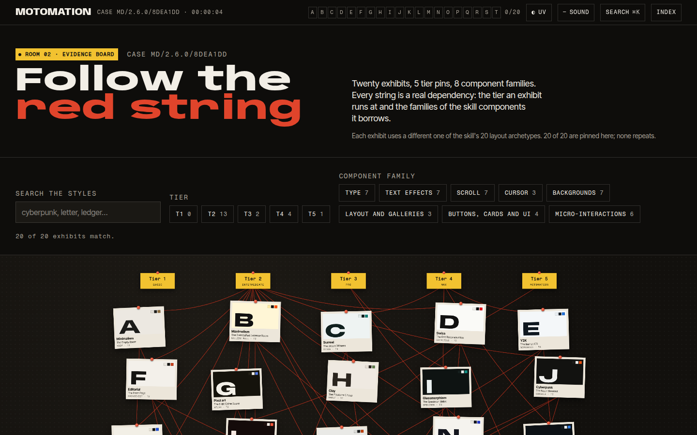
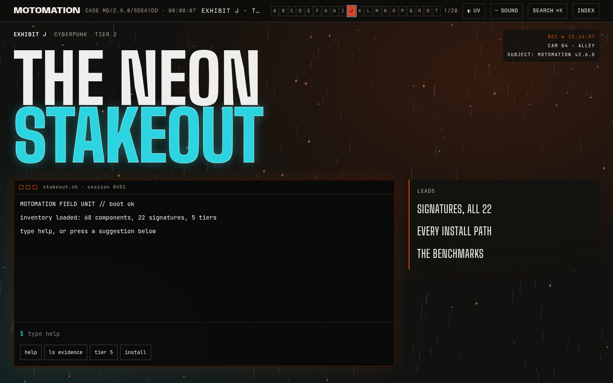
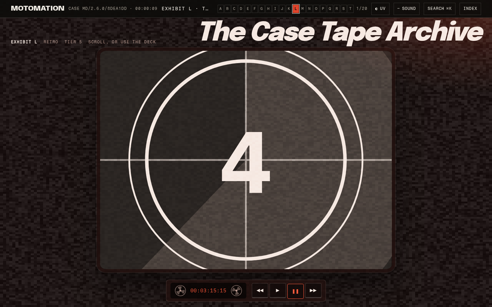
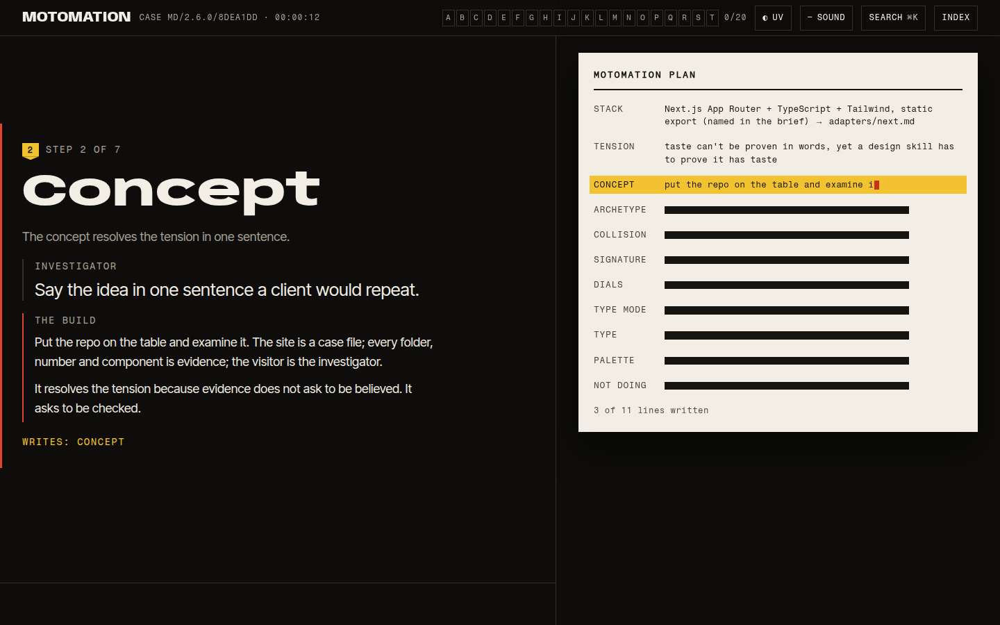
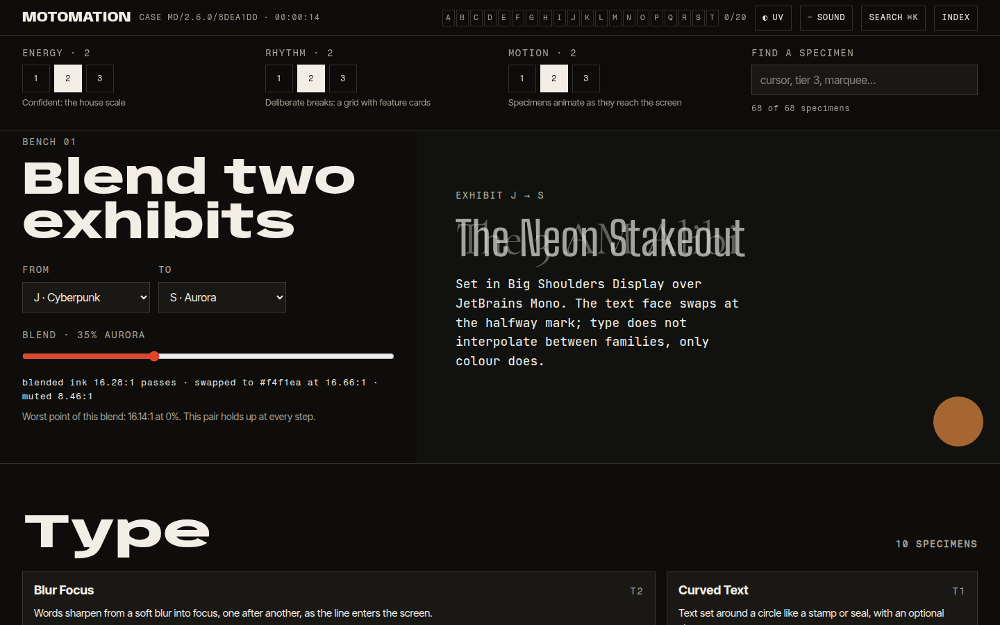
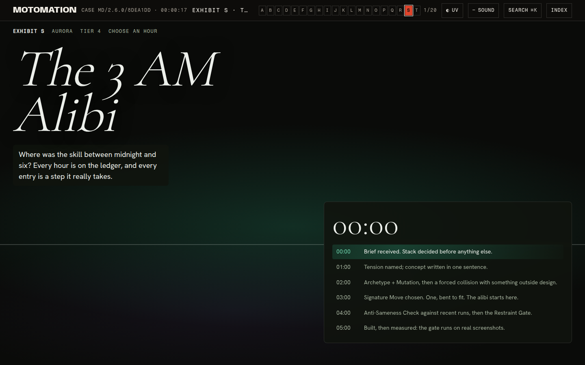
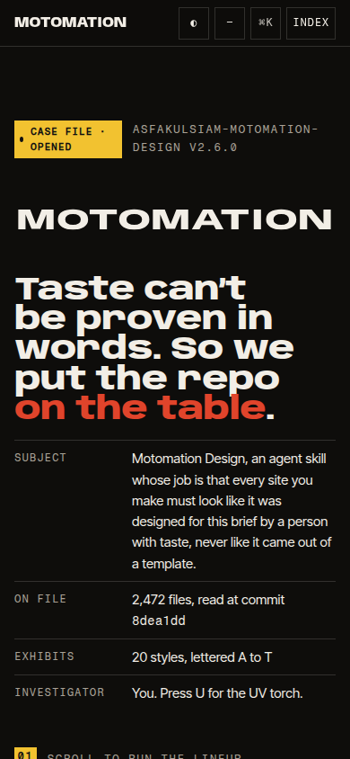
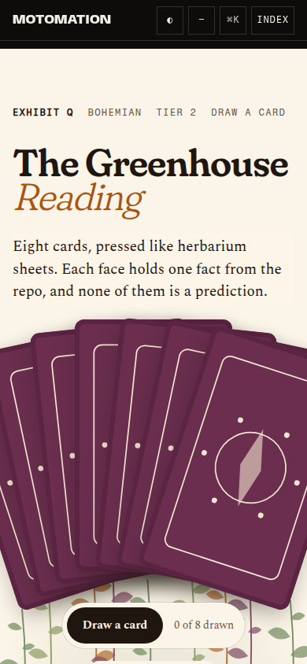
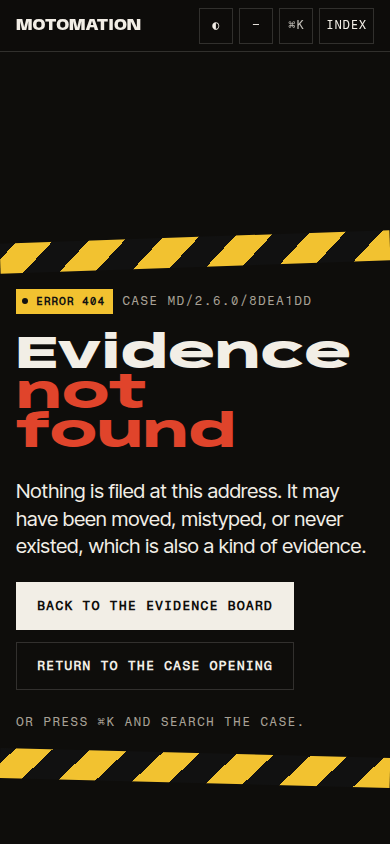

# MOTOMATION · the case file

The official site of [Motomation Design](https://github.com/asfakulsiam/asfakulsiam-motomation-design), the agent skill by Asfakul Islam that makes coding agents design like a person with taste instead of a template. The skill was used to build the site, and the site is about the skill.

The site is a forensic case file. You play the investigator. The repo is the evidence: its 20 styles are Exhibits A to T, its 68 components run live in the Lab, and its benchmarks sit in Receipts, losses included. Every word and number about the skill is read from the repo at commit `8dea1dd` (v2.6.0) by `scripts/inventory.mjs` into `content/repo.json`. Nothing about the skill is typed by hand.

- Live preview: see [Deploy](#deploy)
- Skill: [asfakulsiam/asfakulsiam-motomation-design](https://github.com/asfakulsiam/asfakulsiam-motomation-design)



| | | |
| --- | --- | --- |
|  |  |  |
|  |  |  |
|  |  |  |

## What is on file

| Room | What it holds |
| --- | --- |
| `/` | The cover and the lineup: MOTOMATION morphs through all 20 exhibits' real glyph outlines (Tier 5). Reduced motion gets a photo sheet. |
| `/board/` | All 20 exhibits strung to their tier and component families. Filter, zoom, pan; a table carries the same facts. |
| `/exhibits/[slug]/` ×20 | One style each, built with the skill's own method: archetype, collision, signature, palette, type, restraint gate. |
| `/autopsy/` | The repo opened folder by folder, with the collision engine (same seed, same draw as `collide.mjs`) and a contrast probe. |
| `/method/` | The Thinking Sequence, run on this site, writing the real MOTOMATION PLAN as you scroll. |
| `/lab/` | All 68 components live, three dials that retune the room, a palette bench, and 41 new components filed as candidates. |
| `/receipts/` | Every benchmark exactly as reported, including the motion-only loss and the v4 builds that were never scored. |
| `/locker/` | Every install path as a numbered procedure you can copy and seal. |
| `/dossier/` | Who made it, who it is for, the licence. |
| `/credits/` | Chain of custody: every typeface, library and asset. |
| `/verdict/` | Hidden. Opens when all 20 exhibits are in your tray; draws a PNG poster from your seed. |

The Bureau, the frame around every room, never reloads: case number, evidence tray A to T, UV torch (press U), ⌘K search over the whole case, and sound that stays off unless you say yes.

## Coverage

`scripts/coverage.mjs` runs after every build and fails it if anything in the inventory is missing from the built HTML. Current result, from `coverage.json`:

components 68/68 · signatures 22/22 · tiers 5/5 · archetypes 20/20 · Thinking Sequence steps 8/8 (Step 0 plus 1 to 7) · commands 21/21 · install paths 11/11

## Install

```bash
git clone https://github.com/dev-asfakul/motomation-studio && cd motomation-studio
npm ci
npm run build        # static export to out/, then postbuild and the coverage check
npm start            # serves out/ on http://localhost:3000 with the production headers
```

`content/repo.json` is committed, so the build works without the skill checkout. To refresh it from the skill, clone the skill next to this folder as `../skill-src` (or set `SKILL_SRC`) and run `npm run inventory`.

Checks:

```bash
npm run qa           # layout QA: every route at 320, 375, 390, 768, 1440, 1920 (docs/qa.json)
GATE=../skill-src/skills/asfakulsiam-motomation-design/scripts/gate.mjs node scripts/gate-run.mjs / /exhibits/cyberpunk/
node scripts/gate-summary.mjs   # docs/gate/*.json → content/gate-results.json and docs/gate/SUMMARY.md
```

## Stack

Next.js 16 (App Router, static export) · React 19 · TypeScript 5.9 strict · Tailwind CSS 4 · GSAP 3 (ScrollTrigger, MorphSVG) · Lenis · Three.js (four scenes: C, E, O, S, lazy, with designed posters) · Web Audio (every sound synthesised) · Playwright for screenshots, QA and the gate.

The 68 skill components are vendored unchanged in `src/vendor/motomation/`. The 41 new components in `src/components/originals/` each carry the skill's header format and are listed in `content/originals.json`. Styles the skill does not have are written in its own format in `skill-extensions/styles/` (16 files) and proposed upstream, never passed off as the skill's.

Decisions, one line of why each: [DECISIONS.md](DECISIONS.md). Design plan: [DESIGN.md](DESIGN.md). Motion: [MOTION.md](MOTION.md).

## Credits

Typefaces are SIL Open Font License, self-hosted at build time. There is no stock photography, illustration or audio: images are SVG, canvas or shaders written for this site, and sound is synthesised. The full list, with licences, is in [CREDITS.md](CREDITS.md) and on `/credits/`. Motomation Design is © 2026 asfakulsiam, MIT.

## Gate results

GATE_RESULTS

## Deploy

DEPLOY_LINE

## Licence

MIT. See [LICENSE](LICENSE).
